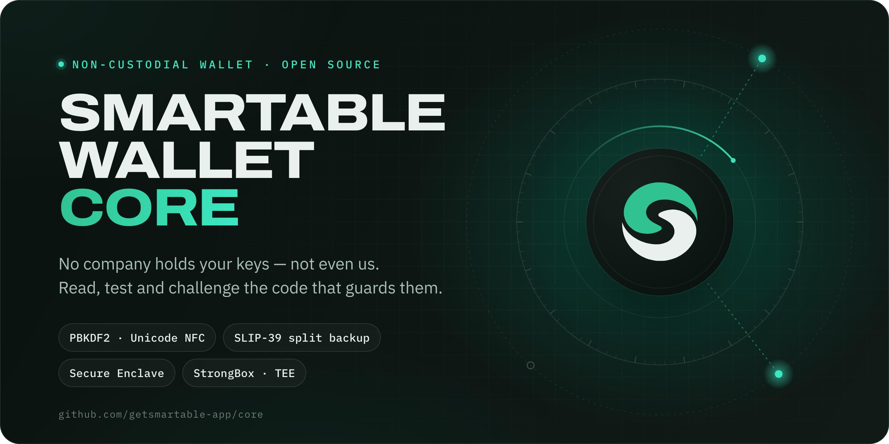

<div align="center">



<br>

[](https://github.com/getsmartable-app/core/actions/workflows/ci.yml)
[](https://github.com/getsmartable-app/core/actions/workflows/dependencies.yml)
[](https://securityscorecards.dev/viewer/?uri=github.com/getsmartable-app/core)
[](https://github.com/getsmartable-app/core/releases)
[](LICENSE)
[](#whats-inside)

[What's inside](#whats-inside) ·
[Principles](#principles) ·
[Quick start](#quick-start) ·
[Checks and releases](#checks-and-releases) ·
[Changelog](CHANGELOG.md) ·
[Security](#security) ·
[Contributing](CONTRIBUTING.md) ·
[License](#license)

</div>

---

[Smartable Wallet](https://getsmartable.app) is a non-custodial wallet: no
company holds your keys — not even us. This repository publishes the part of
the app that keeps that promise on the phone: how a typed password becomes key
material, where secrets are stored, how the app PIN and its lockout work, how a
recovery phrase is split for backup, and the hardware key the wallet is sealed
under. It is here so that anyone can read it, run its tests and challenge it.

It is not a build of the app. The screens, the blockchain integrations, the
transaction review and the backend stay proprietary — see
[What is not here](#what-is-not-here).

> [!IMPORTANT]
> **No independent security audit has been completed.** The code has had
> maintainer review and AI-assisted review, recorded in
> [SECURITY_REVIEW.md](SECURITY_REVIEW.md). Neither is an audit.

## What's inside

| Area | Files | What it does |
|---|---|---|
| **A typed secret becomes a key** | `crypto_utils.dart`<br>`unicode_nfc.dart` | Every password, PIN and backup passphrase is first put in one form, Unicode NFC, so the same word typed on two keyboards is the same key. Then PBKDF2-HMAC-SHA256 at 600,000 rounds — or, for a split-backup share, which can be guessed at away from the phone, Argon2id with 64 MiB of memory per guess. |
| **The recovery phrase, sealed** | `vault_keeper.dart`<br>`password_policy.dart`<br>`seed_vault.dart`<br>`password_recovery.dart` | Each recovery phrase is written under a random key of its own that nobody types, and the password only wraps that key. A password has at least twelve characters and is not mostly a pattern before anything is sealed under it. The PIN and biometric unlock each seal that key and the key imported private keys are encrypted under — never the phrase — and open only the wallet they were set up for. |
| **Encrypted or not stored** | `secure_storage.dart` | Secrets go to the platform keystore or nowhere — no plaintext fallback. A secret that cannot be decrypted is reported, never deleted. |
| **A key the app can use and cannot read** | `hardware_key.dart`<br>`key_backing.dart`<br>`native/android/main/HardwareVaultKey.kt`<br>`native/ios/main/HardwareVaultKey.swift` | The wallet's unlock keys are sealed by a key in Android Keystore — StrongBox, then the TEE — or in the iOS Secure Enclave. Which one actually holds it is reported, not assumed. |
| **The app PIN** | `pin_lock.dart`<br>`native/android/main/PinPepperKey.kt`<br>`native/ios/main/PinPepperKey.swift` | Six digits, passed first through a key in the phone's key store — HMAC in Android Keystore, StrongBox where there is one, or ECDH in the Secure Enclave — then sealed by a second device key. Every guess is a key-store operation on that phone, so the million PINs cannot be carried off to a faster machine. On Android 15 and later both keys work only while the phone is unlocked. An unlocked, rooted phone is not protected. |
| **Biometric unlock** | `quick_unlock.dart`<br>`native/*/main/HardwareVaultKey.*` | Face ID, Touch ID or a Class 3 biometric on Android, bound to a key that is released once per use. The phone's own passcode or pattern never opens the wallet. `quick_unlock.dart` decides when the option is offered at all. |
| **One lockout** | `unlock_throttle.dart`<br>`device_uptime.dart`<br>`native/*/main/DeviceUptime.*` | Wrong guesses are counted on one counter and the wait is measured on the boot clock, so changing the date does not end it. |
| **Split backup** | `slip39.dart`<br>`slip39_wordlist.dart`<br>`sealed_share.dart`<br>`share_store.dart`<br>`paper_share_store.dart` | SLIP-39 Shamir backup — the app offers 2-of-3 and 3-of-5. Each share is sealed under a key derived from the wallet password before it leaves the device. A share written on paper leaves only a note on the phone — which backup, which share — never its words. |

Dart files are under `lib/core/`, their tests under `test/`. The native files
are published for review; the core has no Android or iOS project to build them
in.

## Principles

- **Keys stay with their owner.** No server-side signing, no recovery
  authority held by anyone else, no key kept by a backend.
- **Fail closed.** A keystore that refuses is an error the person sees, never a
  quiet fallback to somewhere weaker.
- **Report, do not reassure.** What the hardware actually provides is read and
  stated; nothing claims protection the device did not give.
- **The clock is not trusted.** Lockouts run on time since boot, which a
  settings screen cannot wind back.
- **Every rule has a test.** SLIP-39 is held to SatoshiLabs' published
  vectors and Unicode normalisation to the Unicode Consortium's, and every
  reproduced finding keeps a regression test.

## Quick start

Flutter 3.44.8 — the version the app is built with:

```bash
git clone https://github.com/getsmartable-app/core.git
cd core
flutter pub get --enforce-lockfile
flutter analyze
flutter test
```

On macOS the tests need full Xcode, not only the Command Line Tools:
`webcrypto` compiles BoringSSL for the test host.

## Checks and releases

| Check | What it runs | When |
|---|---|---|
| [CI](.github/workflows/ci.yml) | `flutter analyze` and the full test suite, on Linux and macOS | Every push and pull request |
| [Dependencies](.github/workflows/dependencies.yml) | [OSV-Scanner](https://google.github.io/osv-scanner/) against every package in `pubspec.lock` | Every push, and weekly |
| [Scorecard](.github/workflows/scorecard.yml) | [OpenSSF Scorecard](https://securityscorecards.dev): pinned actions, token permissions, branch protection, security policy | Weekly, and on changes to branch protection |
| [Release](.github/workflows/release.yml) | The tag, `pubspec.yaml` and the changelog checked against each other, the tests, then a source archive, its SHA-256 and a signed provenance attestation | Every version tag |

Every action is pinned to a full commit SHA. Dependencies are pinned to the
exact versions the app ships, and `--enforce-lockfile` refuses any other.

**Versions.** The core has its own version, following Semantic Versioning: a
major version means data written by an earlier one can no longer be read.
Every change is recorded in [CHANGELOG.md](CHANGELOG.md), with the Smartable
Wallet release its files came from. How versions are numbered and made:
[docs/releasing.md](docs/releasing.md).

**Each release is kept.** A new version is added to
[Releases](https://github.com/getsmartable-app/core/releases) beside the earlier
ones. To check that an archive is the one this repository built from its tag:

```bash
sha256sum -c SHA256SUMS
gh attestation verify smartable-wallet-core-vX.Y.Z.tar.gz --repo getsmartable-app/core
```

The attestation proves where the archive came from. It does not prove that an
app binary was built from this source; no reproducible build is claimed.

## Security

**Reporting a vulnerability.** Please report it privately to
[hello@getsmartable.app](mailto:hello@getsmartable.app), not as a public issue.
Never include a recovery phrase, private key or password. Response targets and
disclosure are in [SECURITY.md](SECURITY.md).

| Check | Status |
|---|---|
| Independent security audit | Not completed |
| Maintainer review | Ongoing |
| AI-assisted review | Performed during development; not an audit |
| Reproducible builds | Not yet verified |

A passing test proves only the behaviour it exercises.

## What is not here

The app's screens, its blockchain integrations, transaction review and
signing, the backend and its routing and fees, deployment configuration and
release records. [PUBLISHED_SOURCES.md](PUBLISHED_SOURCES.md) lists what is
published and what is not.

## Feedback

Bug reports and questions are welcome as
[GitHub issues](https://github.com/getsmartable-app/core/issues), and changes
as pull requests — this repository is assembled from the application's source,
so [CONTRIBUTING.md](CONTRIBUTING.md) explains how a change arrives. Security
issues go privately, as above.

## Trademarks

The Apache-2.0 licence covers the code. It does not cover the Smartable
and Smartable Wallet names, the logo — including where it appears
in `docs/` — the domains or the application identifiers. A fork must use a name
and an identity of its own: in a wallet, the name is what tells a person which
build is holding their keys. See
[PUBLISHED_SOURCES.md](PUBLISHED_SOURCES.md#licensing).

## License

Licensed under the [Apache License, Version 2.0](LICENSE). Third-party material
keeps its own licence — see [NOTICE](NOTICE),
[THIRD_PARTY_NOTICES.md](THIRD_PARTY_NOTICES.md) and [LICENSES/](LICENSES).

This software is provided "as is", without warranty of any kind. Nobody, the
authors included, can recover a lost recovery phrase or reverse a confirmed
transaction.
